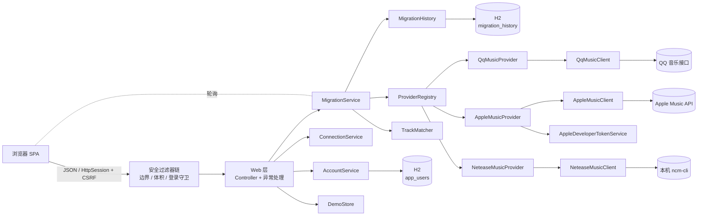
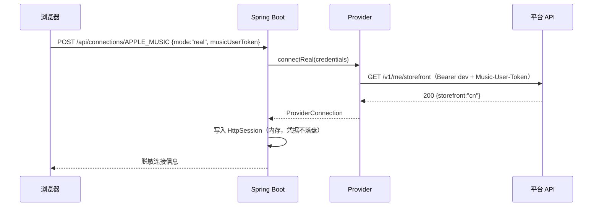
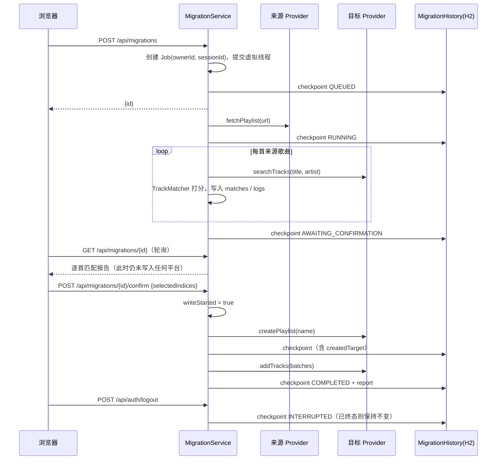

# TuneBridge 音桥 · 技术方案

> 版本：v1.1｜更新日期：2026-11-19｜技术栈：Java 21 + Spring Boot 3.4 + Spring Security + H2 + 原生 Web

## 1. 设计目标

1. **一条主流程走通**：登录音桥账号 → 授权 → 粘贴链接 → 匹配 → 勾选确认 → 写入 → 报告。
2. **真实适配器 + 演示降级**：真实 API 可用时走真实链路；没有凭据或接口受限时，仍能完整演示产品价值。
3. **平台隔离**：QQ、Apple、网易云的协议差异收敛在 Provider 适配层，迁移编排不感知平台细节。
4. **凭据安全**：音乐平台票据只存在服务端会话内存，不进数据库、不进日志；落盘的只有音桥账号与任务报告快照。
5. **可恢复但不可自动重试**：任务状态与报告持久化，服务重启后如实标记中断，绝不自动继续写入。
6. **部署边界可验证**：本机自用与公网多人访问是两套互斥配置，不合规直接拒绝启动。
7. **可扩展**：新增 Spotify 等平台只需实现 `MusicProvider`。

## 2. 技术选型

| 层 | 选型 | 理由 |
| --- | --- | --- |
| 语言 | Java 21 | 比赛要求 Java 方案；虚拟线程适合 I/O 密集的逐首匹配 |
| 框架 | Spring Boot 3.4.2 | 内嵌 Tomcat、RestClient、Jackson、测试支持完善 |
| HTTP 客户端 | Spring `RestClient` | 同步、类型化、超时配置简单 |
| 前端 | 原生 HTML/CSS/JS | 无构建链、加载快、单文件易部署，黑客松效率最高 |
| 账号与安全 | Spring Security 6.4 | 表单登录、会话固定防护、CSRF、PBKDF2 编码器开箱可用 |
| 持久化 | Spring JDBC + H2（file / mem） | 两张表足够；零外部依赖，测试用内存库即可复现 |
| 会话 | `HttpSession`（cookie 跟踪）+ 内存凭据 | 平台票据不入库；退出或服务重启即失效 |
| 任务 | `ConcurrentHashMap` + 虚拟线程 | 迁移任务异步执行，前端轮询进度，状态变更同步落库 |
| 测试 | JUnit 5 + MockMvc + AssertJ + spring-security-test | URL 解析、匹配算法、演示链路、认证与边界、历史恢复 |
| 构建 | Maven | 环境已具备 |

## 3. 总体架构



### 3.1 分层

```
web/          控制器、DTO、全局异常处理
security/     账号、过滤器链、部署策略、认证限流
service/      连接管理、迁移编排、匹配算法、迁移历史
provider/     MusicProvider SPI + QQ / Apple / 网易云 / Demo 实现
domain/       领域模型（Track、Playlist、Connection、Job）
config/       属性绑定、RestClient、线程池
```

依赖方向：`web → security / service → provider → domain`。`MigrationHistory` 是唯一持久化出口，`MigrationJob` 通过回调 `Consumer<MigrationJob>` 触发落库，Provider 之间不互相依赖。

## 4. 领域模型

```java
enum ProviderId { QQ_MUSIC, APPLE_MUSIC, NETEASE_MUSIC }
enum ConnectionMode { DEMO, REAL }
enum JobStatus { QUEUED, RUNNING, AWAITING_CONFIRMATION, COMPLETED, FAILED, INTERRUPTED }

record ProviderConnection(
    ProviderId provider,
    ConnectionMode mode,
    String accountName,
    Map<String, String> credentials // 仅服务端使用，绝不序列化
) {}

record Track(String providerTrackId, String title, String artist, String album,
             int durationSec, String artworkUrl, int songType) {}

record Playlist(String id, String name, String description,
                String coverUrl, String owner, String webUrl, List<Track> tracks) {}

record CreatedPlaylist(String id, String name, String url, int trackCount,
                       Map<String, String> metadata) {}

record TrackMatch(Track source, boolean matched, boolean lowConfidence,
                  String targetTitle, String targetArtist, String targetAlbum,
                  String targetArtworkUrl, double score, String note) {}

class MigrationJob {                       // 可变、synchronized，状态变更即 checkpoint()
    String id, sessionId, ownerId;         // ownerId = 音桥账号 ID
    ProviderId sourceProvider, targetProvider;
    String sourceUrl, requestedName;
    String sourceLabel;                    // 非空表示本地备份来源（backup://local）
    ConnectionMode targetMode;
    ProviderConnection targetConnection;   // 终态后释放
    JobStatus status; int progress; String currentStep;
    List<LogEntry> logs; List<TrackMatch> matches; Map<Integer, Track> targets;
    List<Integer> selectedIndices;         // 确认勾选的匹配序号（来源顺序）
    Playlist sourcePlaylist;
    CreatedPlaylist createdTarget, result;
    String error, recoveryNotice;
    boolean writeStarted;                  // 是否已进入写入阶段
    void checkpoint();                     // 每次状态变更落库；落库异常 -> 转 Snapshot 只读降级并 INTERRUPTED
}

record Snapshot(String jobId, String ownerId, int progress, String currentStep,
                List<TrackMatch> matches) {          // 落库失败后的内存降级形态（只读，不再写库）
    MigrationJob toJob(...);
}

// web/dto/JobView.java
record JobView(String id, String status, int progress, String currentStep, SourceView source,
               TargetView target, List<LogEntry> logs, List<MatchView> matches, ResultView result,
               String error, String createdAt,
               boolean readOnly, String recoveryNotice,
               CreatedTargetView createdTarget) {     // 唯一入库（CLOB JSON）与出参形态
    JobView asReadOnly();
    JobView interruptedAfterRestart(boolean writeStarted);
}

record AppUser(String id, String username, String passwordHash, Instant createdAt) {}
```

- `JobView` 是**唯一入库的表示**：`migration_history.snapshot` 存它的 JSON，读取一律 `readOnly=true`，不含平台凭据、不含 `ProviderConnection`。
- `writeStarted` 决定恢复文案：写入阶段中断 → 「结果待核查，勿自动重试」；未写入 → 「任务已中断，请重新连接并匹配」。
- `MigrationJob.confirm(indices)` 只接受 `AWAITING_CONFIRMATION` 状态、去重且已匹配的序号；网易云目标额外拒绝重复曲目。

## 5. Provider SPI

```java
public interface MusicProvider {
    ProviderId id();

    String sampleUrl();                          // 前端「一键填充」用的示例链接

    ProviderConnection connectDemo(String sessionId);

    ProviderConnection connectReal(Map<String, String> credentials);

    Playlist fetchPlaylist(ProviderConnection connection, String url);

    List<Track> searchTracks(ProviderConnection connection,
                             String title, String artist, int limit);

    CreatedPlaylist createPlaylist(ProviderConnection connection,
                                   String name, String description);

    void addTracks(ProviderConnection connection, CreatedPlaylist playlist, List<Track> tracks);
}
```

- 真实与演示由 `connection.mode()` 分流；真实连接为 `null`（如 QQ 公开只读）时，适配器只做匿名读取。
- `searchTracks` 返回的 `Track.providerTrackId` 是**目标平台可写入的 ID**（QQ 数字 songId / Apple catalog song id）。
- 适配器内部负责分批、限速、响应码校验、错误翻译；`addTracks` 之后由编排层回读校验（网易云）。
- 网易云不支持作为来源：`fetchPlaylist()` 直接抛 `INVALID_INPUT`，编排层再限制「QQ → 网易云」。

## 6. 接口设计

统一前缀 `/api`，同源 Cookie 会话，**除注册/登录外全部需要音桥账号**。错误格式：

```json
{ "error": "面向用户的中文提示", "code": "PROVIDER_UNAUTHORIZED" }
```

### 6.1 端点

| 方法 | 路径 | 说明 |
| --- | --- | --- |
| GET | `/api/auth` | 当前账号状态，并下发 CSRF 令牌：`{authenticated, username, csrfToken, csrfHeader, registrationAllowed, registrationCodeRequired, mode}` |
| POST | `/api/auth/register` | 注册音桥账号，body：`{username, password, registrationCode?}` |
| POST | `/api/auth/login` | 表单登录（`username` / `password`），成功后更换会话 ID |
| POST | `/api/auth/logout` | 退出：失效会话、清除演示库与活动任务、删除 `JSESSIONID` |
| GET | `/api/state` | 本会话连接状态 + 服务端能力（Apple 令牌、部署模式、网易云可用性） |
| GET | `/api/config` | 前端配置：Apple 开发者令牌（可公开）、示例链接 |
| POST | `/api/connections/{provider}` | 建立连接，body：`{mode:"demo"}` 或 `{mode:"real", cookie? / musicUserToken? / pairingCode?}` |
| DELETE | `/api/connections/{provider}` | 断开并清除凭据 |
| POST | `/api/playlists/preview` | 解析并预览，body：`{provider, url}` |
| GET | `/api/playlists?provider=QQ_MUSIC` | 列出当前连接账号 own 的来源歌单（`[{id,name,url,coverUrl,trackCount}]`，见 §6.6）；未连接 409 `NOT_CONNECTED`，网易云作为来源 400 `INVALID_INPUT` |
| POST | `/api/playlists/backup` | 只读备份（抓取曲目清单，不创建目标歌单） |
| POST | `/api/backups/migrations` | 把浏览器里的备份曲目作为来源恢复迁移，body：`{targetProvider, playlistName?, sourceName?, tracks:[{title,artist,album,durationSec}]}` |
| POST | `/api/migrations` | 创建匹配预览，body：`{sourceProvider, sourceUrl, targetProvider, playlistName?}` |
| GET | `/api/migrations` | 本账号迁移历史分页（`offset` / `limit`，倒序，只读；可选 `source` / `target` / `status` / `from` / `to` 筛选，见 §6.5） |
| GET | `/api/migrations/current` | 本会话活动任务，用于刷新页面后恢复 |
| GET | `/api/migrations/{id}` | 活动任务快照；本账号已结束的任务回落到历史（`readOnly=true`） |
| POST | `/api/migrations/{id}/confirm` | 勾选确认并写入，body：`{"selectedIndices":[0,2,5]}`（整数序号） |
| POST | `/api/migrations/{id}/abandon` | 放弃未确认的预览 |
| GET | `/api/demo/library?provider=QQ_MUSIC` | 演示模式下本次会话创建的歌单 |

写请求必须带 CSRF 头；未登录返回 401 `AUTH_REQUIRED`，越权读取他人任务返回 404 `NOT_FOUND`，请求体上限 64 KB（超限 413），`/api/auth*` 另有按来源与全局窗口限流（超限 429 + `Retry-After: 60`）。

### 6.2 连接状态响应

```json
{
  "connections": {
    "QQ_MUSIC": { "connected": true, "mode": "DEMO", "accountName": "演示账号 · 阿桥" },
    "APPLE_MUSIC": { "connected": false }
  },
  "appleRealReady": false,
  "demoAvailable": true
}
```

### 6.3 迁移任务快照

活动任务与历史条目共用 `JobView`，前端只轮询一个结构（示例为等待确认阶段）：

```json
{
  "id": "mig_xxx",
  "status": "AWAITING_CONFIRMATION",
  "progress": 74,
  "currentStep": "匹配完成，等待勾选确认",
  "source": { "provider": "QQ_MUSIC", "providerLabel": "QQ 音乐", "name": "夏夜循环", "coverUrl": "...", "owner": "阿桥", "trackCount": 12 },
  "target": { "provider": "APPLE_MUSIC", "providerLabel": "Apple Music", "mode": "DEMO" },
  "logs": [{ "at": "12:01:03", "message": "已读取来源歌单《夏夜循环》", "level": "INFO" }],
  "matches": [{ "index": 0, "selected": false, "title": "晴天", "artist": "周杰伦", "album": "叶惠美",
                 "durationSec": 269, "matched": true, "lowConfidence": false,
                 "targetTitle": "晴天", "targetArtist": "周杰伦", "targetAlbum": "叶惠美",
                 "targetArtworkUrl": "...", "score": 91, "note": "标题与歌手一致" }],
  "result": null,
  "error": null,
  "createdAt": "2026-11-19T04:01:00Z",
  "readOnly": false,
  "recoveryNotice": null,
  "createdTarget": { "playlistId": "demo-1", "playlistName": "夏夜循环", "playlistUrl": "demo://playlist/demo-1" }
}
```

- `matches[].index` 即确认接口使用的序号；`score` 是四舍五入后的百分数；`selected` 表示已写入勾选。
- `result` 为 `COMPLETED` 后的统计（`addedCount` / `unmatchedCount` / `skippedCount` / `matchedCount` / `totalCount` / `matchRate` / 目标歌单三件套）。
- `readOnly=true` 的响应没有确认与放弃入口；历史条目全部走这个形态。

历史条目与重启恢复的示例：

```json
{
  "id": "mig_xxx",
  "status": "INTERRUPTED",
  "progress": 74,
  "currentStep": "任务已中断",
  "readOnly": true,
  "recoveryNotice": "服务重启，任务已中断；未开始写入目标平台。请重新登录、连接并匹配，未确认预览不会自动恢复。",
  "createdTarget": null,
  "result": null
}
```

`GET /api/migrations?offset=0&limit=20` 返回 `{ "items": [JobView...], "offset": 0, "hasMore": true }`，按 `createdAt` 倒序，只包含当前登录账号的任务；可选的 `source` / `target` / `status` / `from` / `to` 筛选见 §6.5。

### 6.4 备份恢复（本地来源）

`POST /api/backups/migrations` 不走链接解析：前端把当前预览的曲目直接提交，服务端把每条清洗成 `Track`（去控制符、单字段 ≤300 字符、时长裁剪到 24 小时内），组装成 `Playlist("backup", 名称, "来自本地备份", …, "本地备份", "", tracks)` 交给同一个 `submitJob(...)`。

- 任务记 `sourceUrl = "backup://local"`、`sourceLabel = "本地备份"`，`sourceProvider` 取目标平台（没有真实来源平台可指），因此**不要求来源平台已连接**，也不受「网易云只接受 QQ 来源」限制。
- `JobView` 在 `sourceLabel != null` 时把 `source.provider` 输出为 `LOCAL_BACKUP`，历史与结果页据此显示「本地备份」并隐藏「再迁一次」。
- 之后与链接迁移完全同一条链路：逐首在目标平台搜索 → `AWAITING_CONFIRMATION` → 勾选确认才创建与写入 → 每个状态变更落库，重启后同样只读。
- 单次上限是两道：接口按 `max-tracks × 5` 拒绝明显过大的提交，实际匹配仍按 `max-tracks` 截断并写一条 WARN 日志；`/api/**` 写请求还有 64 KB 请求体上限，前端默认只提交前 `max-tracks` 首并提示超出部分不会提交。

### 6.5 历史筛选与导出

筛选在 SQL 层完成，`migration_history` 因此多了 `source_provider` 与 `target_provider` 两列（`save()` 直接取 `JobView.source().provider()` / `target().provider()`，本地备份来源落库为 `LOCAL_BACKUP`）：

```
GET /api/migrations?offset=0&limit=20&source=QQ_MUSIC&target=APPLE_MUSIC&status=COMPLETED&from=2026-11-01&to=2026-11-21
```

- 取值白名单来自枚举本身：`source` ∈ `ProviderId` + `LOCAL_BACKUP`，`target` ∈ `ProviderId`，`status` ∈ `JobStatus`；输入先 `trim` 再按 `Locale.ROOT` 大写，不在白名单内返回 400 `INVALID_INPUT`，SQL 只出现绑定参数，不拼接用户输入。
- 时间是左闭右开：`from` 含当天，`to` 不含当天。`YYYY-MM-DD` 按 UTC 当天零点解析（`to` 取次日零点，因此「止于某天」包含整天），也接受带时区的完整 ISO 时间；前端日期控件提交的是本地日历日，边界差异只会影响跨时区当天数据，报告本身仍以 `createdAt` 为准。
- `from >= to` 直接 400，分页边界（`offset ≤ 100000`、`1 ≤ limit ≤ 50`）与账号隔离规则不变。
- 老库升级：`schema.sql` 用 `ALTER TABLE … ADD COLUMN IF NOT EXISTS` 补列，启动时 `recoverInterrupted()` 顺带把 `source_provider IS NULL` 的历史行按快照内容回填，回填后筛选与导出对旧数据同样有效。

导出全部在前端完成，不新增写接口：`history-report.js` 提供 `summaryCsv(items, formatDate?)`（当前筛选的摘要，前端分页拉取 `limit=50`，最多 500 份）、`matchesCsv(job)`（单份报告的逐首明细）与 `reportJson(job)`（含 `matches` 与 `logs` 的完整快照）。CSV 一律加 UTF-8 BOM，单元格以 `=`、`+`、`-`、`@`、Tab 或换行开头时前置单引号，避免表格公式注入；摘要时间用页面同一套本地时区格式化函数，和列表显示一致。

### 6.6 批量迁移（前端排队，服务端零改动）

服务端仍坚持「同一账号同时只有一个未结束任务」（`submitJob` 返回 409 `ACTIVE_JOB`），因此批量迁移**不新增任务模型**：队列完全在浏览器里，由 `playlist-batch.js` 这个纯函数 UMD 模块维护，`app.js` 每点一次「迁移下一份」才提交一份，复用 §7 的单任务生命周期（提交 → 轮询 → `AWAITING_CONFIRMATION` → 勾选确认 → 写入 → 落历史）。

- 来源列表：`MusicProvider.listPlaylists(connection)` 新增 SPI，`GET /api/playlists?provider=` 直接调用。演示模式由 `DemoPlaylists.of(...)` 输出内置歌单 + 本会话演示库歌单；QQ 走 `fcg_user_created_diss`（`vec_diss[]`，取 `disstid / title / song_count / covermidts[0].cover_mid`，最多 50 份）；Apple 走 `/v1/me/library/playlists`（只保留 `p.` 开头的资料库歌单，该接口不返回曲目数，`trackCount = 0` 表示未知，`attributes.url` 缺失时按 storefront 拼资料库链接）；网易云只作目标，直接 400。返回 `PlaylistRef(id, name, url, coverUrl, trackCount)`，其中 `url` 就是可直接提交的来源链接。
- 队列状态机：`PENDING → RUNNING → AWAITING_CONFIRMATION → COMPLETED / FAILED / INTERRUPTED / SKIPPED`。`markItem` 只允许改写未结束项，已有最终结果的行不会被迟到的轮询覆盖（`app.js` 用 `batchCurrentUrl` 关联当前任务，非队列任务的状态变化不动队列）。
- 入队去重与上限：`parseLinks` 只接受 `http(s)://`、`demo://`、`backup://`，按行保序、拒绝超长（> 2000 字符）与非链接行并给出原因；`enqueue` 按 `url` 去重，单次最多 10 份，超出的计入 `overflow` 提示用户。
- 跳过与重试：队列内点「暂不迁移」把该行标 `SKIPPED`，并调用 `POST /api/migrations/{id}/abandon` 释放服务端预览——否则未结束的占位任务会挡住下一份（409 `ACTIVE_JOB`）。`FAILED / INTERRUPTED / SKIPPED` 行可「重新排队」回到 `PENDING`；`COMPLETED` 行保留在队列里供批次小结导出，不能删除（报告本身在迁移历史永久保留）。
- 方向锁定：队列非空时 `source / target` 固定，换方向会被拒绝并回退选择框，避免把 A 方向的链接提交到 B 方向。
- 批次小结：`summaryCsv(batch, formatDate?)` 输出 10 列 CSV（含公式防护与 BOM），逐份明细仍走 §6.5 的历史导出，不重复造轮子。
- 失败语义：批量不等于自动重试。提交失败（未连接、链接非法、已有活动任务）会把该行退回 `PENDING` 并把服务端原因写进说明，由用户决定重试、跳过还是清空；写入阶段失败或中断沿用「结果待核查」提示，绝不自动重放。

## 7. 关键时序

### 7.1 真实连接目标平台



### 7.2 匹配 → 确认 → 写入



服务重启时的恢复逻辑（`MigrationHistory.recoverInterrupted()`，`@PostConstruct`）：
把库里仍处于 `QUEUED` / `RUNNING` / `AWAITING_CONFIRMATION` 的行改写为 `INTERRUPTED`，并按 `write_started`
生成「结果待核查，勿自动重试」或「任务已中断，请重新匹配」两种提示。**绝不自动继续或重新写入。**
会话正常结束时 `sessionDestroyed` 监听器同样把该会话的活动任务收敛成终态历史。

## 8. QQ 音乐接入

### 8.1 授权（MVP：Cookie 连接）

从浏览器 `y.qq.com` 复制的 Cookie 中解析：

- 账号：`uin`（`o0` 前缀剥离）或 `qqmusic_uin`、`wxuin`。
- 票据：`qm_keyst`（优先）、`qqmusic_key`、`music_key`。
- CSRF：`g_tk = hash33(key)`，同时用于 `g_tk` 与 `g_tk_new_20200303`。

```java
static int gTk(String key) {
    int hash = 5381;
    for (int i = 0; i < key.length(); i++) {
        hash += (hash << 5) + key.charAt(i);
    }
    return hash & 0x7fffffff;
}
```

连接校验：调用 `music.srfDissInfo.DissInfo/CgiGetDiss`（`dirid:201`，取 1 首）验证登录态；业务码 301/1000 视为失效。校验失败不盲目接受无效凭据，但网络异常时不阻塞演示流程。

### 8.2 读取公开歌单（匿名可用）

```
GET https://c.y.qq.com/qzone/fcg-bin/fcg_ucc_getcdinfo_byids_cp.fcg
    ?type=1&json=1&utf8=1&onlysong=0
    &disstid={dissid}&format=json&platform=yqq.json&needNewCode=0
Referer: https://y.qq.com/
```

关键字段：

- `cdlist[0].dissname`、`logo`、`nickname`、`songlist[]`
- 曲目：`songname`、`singer[].name`、`albumname`、`interval`、`songid`、`songtype`
- `songid` 为数字 ID，直接用于写歌单；`songtype` 写入时使用（缺省 0）。

链接解析支持：

- `https://y.qq.com/n/ryqq/playlist/7300098051`
- `https://i.y.qq.com/n2/m/share/details/taoge.html?id=7300098051`
- 裸数字 ID、`dissid` / `disstid` 参数。

### 8.3 写入歌单（Cookie 登录态）

网关：`POST https://u.y.qq.com/cgi-bin/musicu.fcg`，JSON 信封：

```json
{
  "comm": {
    "ct": 24, "cv": 4747474, "platform": "yqq.json",
    "uin": "<uin>", "g_tk": 5381, "g_tk_new_20200303": 5381,
    "authst": "<qm_keyst>", "format": "json",
    "inCharset": "utf-8", "outCharset": "utf-8",
    "notice": 0, "need_new_code": 1
  },
  "req_0": { "module": "...", "method": "...", "param": {} }
}
```

| 操作 | module / method | param | 成功判定 |
| --- | --- | --- | --- |
| 创建歌单 | `music.musicasset.PlaylistBaseWrite/AddPlaylist` | `{dirName, dirDesc:"", dirPicUrl:"", taglist:"", dirShow:2}` | 业务块 `code=0` 且 `data.retCode=0`；取 `result.dirId/tid` |
| 批量加歌 | `music.musicasset.PlaylistDetailWrite/AddSonglist` | `{dirId, tid, bFmtUtf8:true, v_songInfo:[{songId,songType}]}` | 内层 `retCode=0`；每批 100 首 |

**校验原则**：HTTP 状态、外层 `code`、目标业务块 `code`、`data.retCode` 逐层检查；任何非零都失败。`80105` 等业务错误不当作登录失效，原样翻译为用户可读提示。若上游要求签名加密通道（`musics.fcg` + `zzc` 签名 + `ag-1`），MVP 明确报错并建议使用演示模式，不伪造成功。

歌单链接：`https://y.qq.com/n/ryqq/playlist/{dirId}`。

### 8.4 搜索（Apple → QQ 匹配）

两条通道合并去重：

1. **Smartbox（中文友好）**：
   `GET https://c.y.qq.com/splcloud/fcgi-bin/smartbox_new.fcg?key={title}&format=json&inCharset=utf-8&outCharset=utf-8&platform=yqq.json`
   返回 `data.song.itemlist[]`：`id`（数字 songid）、`mid`、`name`、`singer`。
2. **musicu 搜索（英文友好）**：
   `music.search.SearchCgiService/DoSearchForQQMusicDesktop`，参数 `{search_type:0, query:"title artist", page_num:1, num_per_page:8}`。

候选再按标题与歌手相似度排序，取最高分。中文查询只传歌名，避免 Smartbox 组合词返回空。

## 9. Apple Music 接入

### 9.1 授权

**浏览器 MusicKit JS（推荐）**：

1. 服务端配置开发者令牌（静态 `APPLE_DEVELOPER_TOKEN`，或用 `.p8` 现场签发）。
2. 前端加载 `https://js-cdn.music.apple.com/musickit/v3/musickit.js`。
3. `MusicKit.configure({ developerToken, app: { name: "TuneBridge", build: "1.0" } })`。
4. `await music.authorize()` 得到 `musicUserToken`，POST 给后端。
5. 后端携带 `Music-User-Token` 调用 `/v1/me/storefront` 校验。

**手动回退**：用户从 MusicKit 调试工具/其他合法途径获得 Music-User-Token 后粘贴。

### 9.2 开发者令牌签发（可选）

若未配置静态令牌，可配置 `APPLE_TEAM_ID`、`APPLE_KEY_ID`、`APPLE_PRIVATE_KEY_PATH`（`.p8`）：

- 读取 PKCS#8 EC 私钥；
- JWT Header：`{"alg":"ES256","kid":"<keyId>","typ":"JWT"}`；
- Payload：`{"iss":"<teamId>","iat":now,"exp":now+3600}`；
- 使用 `SHA256withECDSAinP1363Format` 签名（JWT 要求 raw R||S）；
- 缓存 55 分钟，提前刷新。

> 开发者令牌可安全下发给浏览器（Apple 官方允许 Web 端嵌入），Music-User-Token 只留服务端会话。

### 9.3 读取歌单

| 类型 | 请求 |
| --- | --- |
| 目录歌单（`pl.` 开头） | `GET /v1/catalog/{storefront}/playlists/{id}` + `/tracks?limit=100&offset=N` |
| 资料库歌单（`p.` 开头） | `GET /v1/me/library/playlists/{id}` + `/tracks?limit=100&offset=N` |

Headers：

```
Authorization: Bearer <developerToken>
Music-User-Token: <musicUserToken>   // 资料库/写操作必需
```

字段映射：`attributes.name / artistName / albumName / durationInMillis / artwork.url`（替换 `{w}x{h}`）。

链接解析：

- `https://music.apple.com/cn/playlist/xxx/pl.u-xxxx`
- `https://music.apple.com/cn/album/xxx/123456?i=...`（专辑不在 MVP）
- 裸 `pl.` / `p.` ID。

### 9.4 创建与写入

1. `POST /v1/me/library/playlists`

```json
{
  "attributes": { "name": "歌单名", "description": "由 TuneBridge 迁移" }
}
```

2. 取响应 `data[0].id`（`p.` 开头）。
3. 分批 `POST /v1/me/library/playlists/{id}/tracks`，每批最多 100：

```json
{ "data": [{ "id": "<catalogSongId>", "type": "songs" }] }
```

4. 目标链接：`https://music.apple.com/{storefront}/library/playlist/{id}`。

### 9.5 搜索

```
GET /v1/catalog/{storefront}/search?term={title artist}&types=songs&limit=5
```

取 `results.songs.data[]`，映射为候选。请求间隔 120ms，避免触发限流；单次迁移默认上限 200 首。

## 10. 网易云接入（试用 · 仅本机）

网易云没有可用的公开写接口，MVP 用**本机 `ncm-cli` 子进程**打通「QQ 音乐 → 网易云」这一个方向，作为可部署形态之前的试用能力。

- **只作目标平台**：`fetchPlaylist()` 直接返回 400「网易云音乐暂不支持作为来源平台」；`MigrationService` 也只放行「来源 QQ → 目标网易云」。
- **配对码连接**：`POST /api/connections/NETEASE_MUSIC {mode:"real", pairingCode}` → `NeteaseLocalAccess.authorize()` 用 `MessageDigest.isEqual` 定长比对配置里的 `tunebridge.netease.pairing-code`（`[A-Za-z0-9_-]{32,128}`），通过后签发一个随机 grant 存入会话；随后 `client.validateLogin()` 失败即回收 grant。
- **grant 而非凭据**：会话里保存的是 32 字节随机 grant，网易云登录态由 CLI 自己管理（属本机数据），服务端不接触 Cookie / 密码。断开连接或退出登录即 `revoke(grant)`。
- **CLI 调用**：`node <cli-entry> search song|playlist create|playlist add|playlist tracks … --output=json`，参数经转义后由 `ProcessBuilder` 启动（丢弃 stderr、超时强制销毁进程），响应逐层校验后翻译成领域模型；每批加歌同样受 200 首上限约束。
- **本机边界**：配置了配对码才启用 `NeteaseLocalGuard` 过滤器——要求回环地址、`Host` 与本地端口一致、写请求 `Origin` 同源、无转发头、非 `cross-site`，否则 403。`server.address` 非 `127.0.0.1` 或开启转发头处理时启动失败；PUBLIC 模式配置网易云相关键值同样拒绝启动。
- **目标去重**：`MigrationJob.confirm()` 对网易云目标额外拒绝同一批里重复的曲目，避免 CLI 端产生重复行。

## 11. 歌曲匹配算法

```java
score = 0.55 * titleSimilarity + 0.35 * artistSimilarity + 0.10 * albumBonus
```

- **归一化**：小写、全角转半角、去标点、去 `(Live)`/`feat.`/`remaster` 等版本修饰、压缩空白。
- **标题相似度**：完全相同 = 1；互相包含 = 0.9；否则字符级 Dice 系数。
- **歌手相似度**：分词后 Jaccard / 包含关系；多歌手取最佳。
- **专辑**：归一化后相同 +0.1（加分项，不做硬条件）。
- **阈值**：≥ 0.72 接受；0.55–0.72 标记为「低置信」但仍写入并在报告中注明；< 0.55 视为未匹配。
- **版本提示**：标题包含 Live/Remix/Acoustic 且目标不含时，降低 0.08 并在报告中提示。

匹配结果全部保留，用户能看到「为什么匹配到这首」。

## 12. 演示模式

- `DemoCatalog`：内置 QQ 风格歌单（12 首）与 Apple 风格歌单（10 首），覆盖中英文、Live 版本、目标缺失歌曲。
- `DemoStore`：按 `sessionId + provider` 保存迁移创建的歌单，线程安全。
- `demo://builtin`：读取内置歌单；`demo://library/{id}`：读取本会话创建的演示歌单。
- 演示适配器执行与真实链路相同的匹配、创建、写入流程，只是不发外部请求。
- 迁移报告中的目标链接为 `demo://playlist/{id}`，前端识别后打开「演示音乐库」。
- 演示连接与演示库绑定音桥账号的浏览器会话：退出登录或会话销毁即清除，迁移报告仍存入该账号的历史。
- 网易云只在 LOCAL 部署提供演示模式（本机配对与 CLI 登录态属本机数据），PUBLIC 配置直接拒绝启动。

## 13. 安全设计

### 13.1 账号与会话

- **音桥账号**：`app_users` 只存 `id / username / PBKDF2 哈希`（`Pbkdf2PasswordEncoder.defaultsForSpringSecurity_v5_8`）。用户名限 `[A-Za-z0-9_]{3,32}` 并统一小写，密码 12–128 字符；重名与弱输入统一返回 `REGISTRATION_FAILED`，不泄露账号是否存在。
- **登录**：Spring Security 表单登录 `POST /api/auth/login`（`username` / `password` 表单字段），成功后 `sessionFixation().changeSessionId()` 防会话固定；失败统一 401 `LOGIN_FAILED`。
- **退出**：`POST /api/auth/logout` 失效会话、清除认证、删除 `JSESSIONID`；`HttpSessionListener` 在会话销毁时结束该会话的活动任务并清空演示库。
- **PUBLIC 注册门槛**：注册码 32–128 字符，`MessageDigest.isEqual` 定长比较；LOCAL 免邀请码。

### 13.2 过滤器链顺序

| 顺序 | 过滤器 | 职责 |
| --- | --- | --- |
| 1 | `HeaderWriterFilter` | 先写安全响应头，保证被拒绝的请求同样带 CSP / `X-Frame-Options` / `Referrer-Policy` / `Cache-Control: no-store` |
| 2 | `BoundaryFilter` | 调用 `DeploymentPolicy.allows()`，不合规 403 `BOUNDARY_REJECTED`；`/api/auth*` 走 `AuthRateLimiter`（默认每来源 60 次/分钟、全局 2000 次、最多 4096 个来源），超限 429 `RATE_LIMITED` + `Retry-After: 60` |
| 3 | `ApiBodyLimitFilter` | `/api/**` 写请求体上限 64 KB（超限 413），拒绝非 `identity` 编码（415）；请求体与查询串限量解析（≤128 个参数、查询串 ≤8192 字符），包装成可重复读的请求 |
| 4 | `CsrfFilter` / `LogoutFilter` | Spring Security 内建 CSRF 校验与退出 |
| 5 | `LoginGuardFilter` → `UsernamePasswordAuthenticationFilter` | 已登录不得再登录（409）；表单字段数量、用户名与密码长度先做形式校验（401），不泄露原因 |

自定义过滤器都在 `SecurityConfiguration` 内构造后用 `addFilterAfter` / `addFilterBefore` 注册，不声明成 Servlet `Filter` Bean——避免被 Servlet 容器二次注册而执行两次。

### 13.3 授权与数据隔离

| 面 | 措施 |
| --- | --- |
| 端点授权 | `STATIC_PATHS` 与 `GET /api/auth` + `POST /api/auth/login|register` 放行，`/api/**` 一律需认证，其余 `denyAll()` |
| CSRF | `HttpSessionCsrfTokenRepository` + `XorCsrfTokenRequestAttributeHandler`，前端从 `GET /api/auth` 取令牌并用 `X-CSRF-TOKEN` 头提交；校验失败 403 `CSRF_INVALID` |
| 跨站 | 不开启 CORS（`cors().disable()`）；`Origin` / `Sec-Fetch-Site` 由 `BoundaryFilter` 校验；会话 Cookie `HttpOnly` + `SameSite=Lax`（PUBLIC 再加 `Secure`） |
| 账号隔离 | Job 同时绑定 `ownerId` 与 `sessionId`：跨账号读取 404，同账号跨会话只读（409 `MIGRATION_STATE`）；一个账号同时只允许一个未结束任务，全局最多 16 个 |
| 历史 | `migration_history` 按 `owner_id` 查询，`snapshot` 是 `readOnly=true` 的 `JobView`；无更新/删除接口，确认与放弃一律 409 `HISTORY_READ_ONLY` |
| 凭据存储 | 平台票据只存 `HttpSession` 内存；不落库、不写日志、不返回前端；任务终态后释放 `ProviderConnection` |
| 日志与序列化 | 只打印 provider、账号掩码、任务 ID；`ConnectRequest.toString()` 不含 Cookie/Token 字段值 |
| SSRF | 不请求用户传入的任意 URL；先用正则解析出平台 ID，再调用固定域名 |
| 输入 | 链接严格正则；歌单名去控制符后限长 60；单次曲目上限 200；分页参数 `0 ≤ offset ≤ 100000`、`1 ≤ limit ≤ 50` |
| 写操作 | 只创建新歌单，不修改/删除用户已有歌单；不写入「我喜欢」 |
| 本机能力 | 网易云走本机 `ncm-cli` 子进程，仅 LOCAL + 配对码，PUBLIC 配置该项直接拒绝启动 |
| 传输 | PUBLIC 模式强制**应用原生 TLS**（`server.ssl.enabled=true`），`forward-headers-strategy` 必须为 `none`，不支持反向代理 |

`BoundaryFilter` 与 `DeploymentPolicy` 的完整边界规则见 §14.1；两者都在启动时校验配置，不合规直接拒绝启动。

## 14. 配置与部署

### 14.1 两种互斥的部署模式

`tunebridge.security.mode` 取 `local`（默认）或 `public`，`DeploymentPolicy` 构造时校验：

| 模式 | 启动前置条件 | 请求边界 |
| --- | --- | --- |
| LOCAL | `server.address=127.0.0.1`、`server.forward-headers-strategy=none`；注册免邀请码；允许网易云配对 | 拒绝一切 `Forwarded` / `X-Forwarded-*` / `X-Real-IP`；`Host` 必须唯一且是 `localhost`/`127.0.0.1`/`[::1]`（可带真实端口）；远端与本端地址必须是回环字面量（不做 DNS）；写请求的 `Origin` 必须等于本次请求自身的 scheme+Host，且拒绝 `Sec-Fetch-Site: cross-site` |
| PUBLIC | `server.ssl.enabled=true`、`server.servlet.session.cookie.secure=true`、规范公网源 `https://host[:port]`（小写、无路径/查询/凭证/片段、端口非 443 时才写）、注册码 32–128 字符、禁止网易云配置 | `Host` 必须等于规范源的 authority 且连接必须是 HTTPS，其余同上（`Origin` 与规范源比对） |

LOCAL 就是「这台电脑上的自己用」：不监听公网地址、不接受代理转发的头部，因此不存在被伪造来源绕过授权的路径；PUBLIC 是「多人访问」：TLS 与会话 Cookie 安全位由应用自己保证，注册靠邀请码收口。

### 14.2 配置项

```yaml
server:
  address: ${SERVER_ADDRESS:127.0.0.1}
  port: ${PORT:8080}
  forward-headers-strategy: none
  servlet:
    session:
      timeout: 2h
      persistent: false
      cookie: { http-only: true, same-site: lax, secure: ${SESSION_COOKIE_SECURE:false} }

spring:
  datasource:
    url: "${TUNEBRIDGE_DATABASE_URL:jdbc:h2:file:./data/tunebridge;DB_CLOSE_ON_EXIT=FALSE;WRITE_DELAY=0}"

tunebridge:
  security:
    mode: ${TUNEBRIDGE_SECURITY_MODE:local}
    public-origin: ${TUNEBRIDGE_PUBLIC_ORIGIN:}
    registration-code: ${TUNEBRIDGE_REGISTRATION_CODE:}
  apple:
    developer-token: ${APPLE_DEVELOPER_TOKEN:}
    team-id: ${APPLE_TEAM_ID:}
    key-id: ${APPLE_KEY_ID:}
    private-key-path: ${APPLE_PRIVATE_KEY_PATH:}
    default-storefront: ${APPLE_STOREFRONT:cn}
  netease:            # 仅 LOCAL 模式可用
    pairing-code: ${NETEASE_PAIRING_CODE:}
    node-executable: ${NETEASE_NODE_EXECUTABLE:}
    cli-entry: ${NETEASE_CLI_ENTRY:}
  migration: { max-tracks: 200, batch-size: 100, request-interval-ms: 120 }
  demo: { enabled: true }
```

### 14.3 数据库

`schema.sql` 在启动时幂等建表（`spring.sql.init.mode=always`）：

- `app_users(id, username UNIQUE, password_hash, created_at)`
- `migration_history(id, owner_id → app_users.id, status, write_started, snapshot CLOB, created_at, updated_at)`
  + 索引 `(owner_id, created_at DESC, id)`，支撑倒序分页。

`snapshot` 存 `JobView` JSON，读取即历史。默认使用 `./data/` 下的 H2 文件库（已在 `.gitignore` 中），**测试一律用 `jdbc:h2:mem:`**，不会写入本地数据目录。

### 14.4 运行

- 本机：`mvn spring-boot:run` → `http://localhost:8080`。
- 公网：配置 `TUNEBRIDGE_SECURITY_MODE=public`、证书、注册码等环境变量后 `java -jar target/tunebridge-1.0.0.jar`；**不要用反向代理**（转发头会被 `DeploymentPolicy` 拒绝）。
- 单实例内存任务 + 文件库；多实例需要共享会话与 PostgreSQL（P2），Qoder Sites 仍只适合托管纯静态前端。

## 15. 错误处理

`ProviderException` 统一携带 HTTP 状态、`code` 与中文提示，`ApiExceptionHandler` 直接转成 `{error, code}`；安全过滤器由 `SecurityResponses` 输出同一种结构。

| 场景 | HTTP | `code` | 用户提示 |
| --- | --- | --- | --- |
| 未登录访问任何业务接口 | 401 | `AUTH_REQUIRED` | 请先登录音桥账号 |
| 账号或密码错误 | 401 | `LOGIN_FAILED` | 账号或密码不正确（不泄露是否存在） |
| 已登录又发起登录 | 409 | `LOGOUT_REQUIRED` | 请先退出当前账号后再登录 |
| 缺少 / 错误 CSRF 头 | 403 | `CSRF_INVALID` | 安全令牌已失效，请刷新后手动重试；不会自动重发写入 |
| 来源、Host、转发头不合规 | 403 | `BOUNDARY_REJECTED` | 请求来源不受信任 |
| 登录/注册超频 | 429 | `RATE_LIMITED` | 请求过于频繁，请稍后再试（带 `Retry-After`） |
| 请求体过大 / 编码不支持 | 413 / 415 | `REQUEST_TOO_LARGE` / 其他 | 请求内容过大 / 不受支持 |
| 注册输入不合规或重名 | 400 | `REGISTRATION_FAILED` | 无法注册，请检查用户名、密码或邀请码 |
| 未连接目标或来源平台 | 409 | `NOT_CONNECTED` | 请先连接目标音乐平台 |
| 已有未结束任务 | 409 | `ACTIVE_JOB` | 已有未结束的任务，请回原会话处理 |
| 状态不允许（重复确认/放弃） | 409 | `MIGRATION_STATE` | 任务已不属于当前会话，或不在等待确认状态 |
| 会话内连接与任务快照不一致 | 409 | `TARGET_CHANGED` | 目标平台连接已变化，请重新匹配 |
| 只读历史 | 409 | `HISTORY_READ_ONLY` | 历史任务只读，不会重新执行写入 |
| Cookie 缺 uin/票据、配对码错误、Apple 401 | 401 | `UNAUTHORIZED` | 授权已失效，请重新连接 |
| 未配置 Apple 令牌 / 网易云本机模式 | 503 | `NOT_CONFIGURED` | 服务端未配置，请先使用演示模式 |
| 链接非法、JSON 无法解析、分页越界、曲目 ID 非整数 | 400 | `INVALID_INPUT` / `INVALID_JSON` | 无法识别歌单链接 / 请检查输入 |
| 任务不存在或不属于本账号 | 404 | `NOT_FOUND` | 迁移任务不存在 |
| 平台业务码拒绝写入 | 502 | `UPSTREAM_ERROR` | 平台拒绝了本次写入，请使用演示模式或稍后重试 |
| 上游超时 | 504 | （适配器翻译） | 平台响应超时，请稍后重试 |
| 未捕获异常 | 500 | `INTERNAL_ERROR` | 服务暂时不可用，请稍后重试 |

前端统一解析 `{error, code}`，以 Toast + 行内提示呈现，不使用 `alert`；401 时清空页面私有数据并打开账号弹窗，且不自动重放刚才的写操作。

## 16. 测试计划

共 **101 项 JUnit 测试 + 26 项 Node 测试**，`mvn test` 全绿。所有触达数据库的测试都固定 `spring.datasource.url=jdbc:h2:mem:<name>;DB_CLOSE_DELAY=-1`，不写本地 `./data/`。

### 16.1 单元与适配器测试

- `QqUrlParserTest` / `AppleUrlParserTest`：多种链接形式、地区与查询参数、非法输入。
- `QqCookieTest`：`g_tk` 计算、uin 前缀剥离、票据优先级。
- `TrackMatcherTest`：完全相同、Live 版本、多歌手、完全不同、空值、归一化。
- `NeteaseLocalAccessTest` / `NeteaseMusicClientTest` / `NeteaseMusicProviderTest`：配对码校验与 grant 生命周期、CLI 参数与响应解析、只作目标平台。
- `AuthRateLimiterTest`：注入时钟验证按来源窗口、全局限流与来源数量上限。
- `ConnectionServiceTest`：退出即清除凭据。
- `QqPlaylistListTest`：`fcg_user_created_diss` 响应解析（`vec_diss[]` 的 id / 标题 / 曲目数 / 封面、缺失字段兜底、跳过空 `disstid`）、业务码与结构异常时的降级提示、`limit` 边界。
- `ApplePlaylistListTest`：只保留 `p.` 资料库歌单、`attributes.url` 缺失时按 storefront 拼链接、无曲目数落 0、空数据与超限截断。
- `DemoPlaylistsTest`：内置歌单在前、本会话演示库歌单随后，`demo://library/<id>` 链接与曲目数可直接作为来源。

### 16.2 安全与持久化测试（MockMvc）

- `AccountAuthFlowTest`：注册/登录/退出、CSRF 头必需、缺凭据 400、未登录 401、`/api/**` 需认证、转发头 403。
- `DeploymentPolicyTest`：LOCAL 与 PUBLIC 的启动前置条件与请求边界（Host、Origin、Sec-Fetch-Site、回环地址、规范源、注册码长度）。
- `MigrationHistoryTest`：按 owner 落库与隔离、报告字段完整、倒序分页不越权、非法分页先拒绝再落库、重启标记中断且不重复决策、按来源/目标/状态与时间窗口筛选（含空格与小写归一、非法值 400、`from >= to` 400）、升级后为历史行回填平台列。
- `MigrationHistoryApiTest`：历史只归本账号、他人 404、同账号其他会话只读、历史确认/放弃 409、会话结束后 INTERRUPTED、分页参数越界 400、`GET /api/migrations` 带筛选跨账号不泄漏、筛选值无法映射到平台或状态时 400。
- `StaticResourceAccessTest`：扫描 `index.html` 里引用的每个本地 `js`/`css` 资源，逐一以未登录请求断言 200，防止新增静态文件漏进 `SecurityConfiguration.STATIC_PATHS` 而被 `denyAll()` 拦成 403。
- `SourcePlaylistListApiTest`：`GET /api/playlists` 的演示列表（含会话内新建歌单）、未连接 409 `NOT_CONNECTED`、网易云与 Spotify 作为来源 400、缺参数 400、跨会话互不可见、未登录 401。
- `DemoMigrationFlowTest`：注册登录 + CSRF 下的双向演示迁移、匹配与确认分离、未连接 409、非法链接 400、任务会话隔离，以及备份读取（含 250 首大歌单）与「本地备份 → 已连接平台」的恢复闭环（`source.provider = LOCAL_BACKUP`、无需来源平台连接）。
- `testsupport/BridgeRequests`：统一构造满足 LOCAL 边界的 MockMvc 请求（回环 `Host`、`X-Forwarded-*` 置空、CSRF 走请求头）。

### 16.3 前端与人工验收

- `node --test src/test/js/playlist-backup.test.js src/test/js/history-report.test.js src/test/js/playlist-batch.test.js`：CSV/JSON 备份的解析、转义、公式前缀防护与坏数据拒绝；历史导出的摘要列顺序、逐首匹配表、报告 JSON 结构、本地时间注入与输入校验；批量队列的链接解析与拒绝原因、去重与 10 份上限、状态流转与「最终结果不可改写」、可移除 / 可重新排队的行、批次统计与小结 CSV。
- Chrome / Edge / Safari 桌面端 + 375px 移动端；核心流程 ≤ 5 步、无控制台错误。
- 端到端手工验证：注册 → 连接演示账号 → 粘贴链接 → 匹配 → 勾选确认 → 报告 → 迁移历史；在历史弹窗里按平台/状态/时间筛选（含筛选后为空、重置）、导出摘要 CSV 与逐份报告的 CSV/JSON；批量迁移区读取来源歌单并勾选入队、粘贴多行链接（重复与非链接行被拒）、逐份「迁移下一份 → 确认」、跳过一份后服务端预览被释放且队列可继续、失败项重新排队、导出批次小结、队列非空时换方向被拒；停服重启后历史仍在、未确认预览显示「任务已中断」、写入阶段中断显示「结果待核查」，第二个账号看到 0 条历史且无法读取他人任务。
- 真实 QQ 公开歌单读取（联网）与未配置 Apple 令牌时的降级提示。

## 17. 已知限制与后续演进

1. QQ 真实写入依赖网页登录 Cookie，票据约 3 天过期；后续接入官方开放平台 / 扫码登录。
2. QQ 写接口存在风控与签名通道要求，MVP 采用「如实失败 + 演示兜底」。
3. Apple 真实链路需要开发者账号与订阅；评审演示以演示模式为主。
4. 历史只读、绝不自动重试：写入阶段中断的任务需要人工去目标平台核查后重新迁移；重复迁移会产生新歌单。
5. 会话与活动任务在内存里，服务重启后只能从库里恢复报告，无法恢复未完成的连接；H2 单文件、单实例，多实例需共享会话 + PostgreSQL（P2）。
6. 一个账号同时只允许一个未结束任务、全局最多 16 个活动任务，队列仍是内存态；后续改为消息队列并支持取消/重试。
7. 无后台管理面板：不能改密、找回密码或管理他人账号；PUBLIC 模式靠邀请码与限流收口。
8. 匹配算法为规则型，后续可加入向量检索与用户反馈学习。
9. 部署边界不接受反向代理（转发头一律拒绝），公网必须由应用自身终结 TLS。
10. 备份恢复一次只处理 `max-tracks`（默认 200）首，超出的曲目需要分次提交；恢复出的新歌单与原备份不保证曲目顺序一一对应，因为写入的是目标平台匹配到的曲目。
11. 历史导出在前端完成，一次最多 500 行（按 `limit ≤ 50` 分批拉取），超出部分需要先用时间窗口分段再导；筛选的纯日期边界按 UTC 自然日解释，跨时区用户在同一天边界上可能与本地日历有一天之差（导出的时间列本身用浏览器本地时区渲染）。
12. 批量队列只存在于当前浏览器页面：刷新、关闭标签页或退出登录都会清空队列（已生成的报告仍在迁移历史），换设备需要重新粘贴链接；单次上限 10 份，逐份确认因此无法压缩。跳过一份会调用 `abandon` 释放服务端预览，该份会以「任务已中断」进入历史，这是有意的留痕而不是脏数据。
13. 来源歌单列表只覆盖「账号自己创建 / 资料库内」的歌单：QQ 取 `vec_diss`（上限 50，不含收藏的他人歌单），Apple 资料库接口不返回曲目数（列表显示「曲目数未知」）；平台不提供列表能力时前端退回「粘贴多条链接」。

## 18. 目录结构

```
tunebridge/
├── docs/PRD.md, TECH_DESIGN.md
├── src/main/java/com/tunebridge/
│   ├── config/        # AppConfig（RestClient/线程池/会话销毁监听）、SecurityProperties、TuneBridgeProperties
│   ├── domain/        # MigrationJob(+Snapshot)、Track/Playlist/TrackMatch、PlaylistRef、ProviderConnection、JobStatus
│   ├── security/      # SecurityConfiguration、DeploymentPolicy、Boundary/ApiBodyLimit/LoginGuard 过滤器、
│   │                  # AuthRateLimiter、AccountService/AccountPrincipal/CurrentUser、SecurityResponses
│   ├── provider/      # MusicProvider SPI(+listPlaylists) + qq/ apple/ netease/ demo/（DemoPlaylists）
│   │                  # 与 ProviderRegistry、ProviderException
│   ├── service/       # ConnectionService、MigrationService、MigrationHistory、TrackMatcher
│   └── web/           # ApiController、AuthController、ApiExceptionHandler、dto/JobView 等
├── src/main/resources/
│   ├── application.yml
│   ├── schema.sql     # app_users + migration_history
│   └── static/        # index.html / app.js / playlist-backup.js / playlist-batch.js / history-report.js / styles.css
├── src/test/java/com/tunebridge/
│   ├── testsupport/BridgeRequests.java   # 满足 LOCAL 边界的 MockMvc 请求构造
│   ├── security/  # AccountAuthFlowTest、DeploymentPolicyTest、AuthRateLimiterTest
│   ├── service/   # MigrationHistoryTest、TrackMatcherTest、ConnectionServiceTest
│   ├── web/       # DemoMigrationFlowTest、MigrationHistoryApiTest、SourcePlaylistListApiTest、StaticResourceAccessTest
│   └── provider/  # QQ / Apple / NetEase 解析与适配器测试，含歌单列表（QqPlaylistListTest、ApplePlaylistListTest、
│                  # DemoPlaylistsTest）
├── src/test/js/playlist-backup.test.js, history-report.test.js, playlist-batch.test.js
├── pom.xml
└── README.md
```

