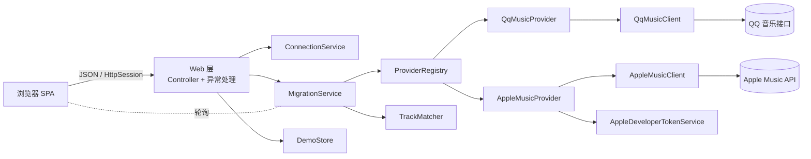
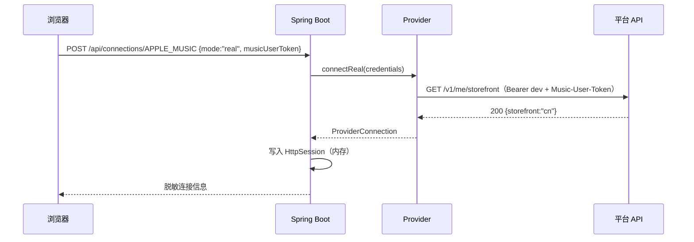
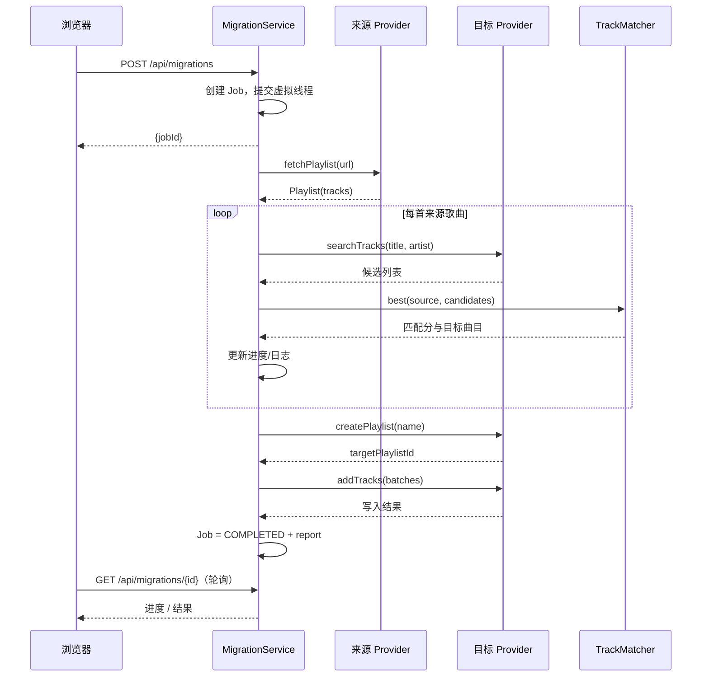

# TuneBridge 音桥 · 技术方案

> 版本：v1.0（MVP）｜更新日期：2026-11-18｜技术栈：Java 21 + Spring Boot 3.4 + 原生 Web

## 1. 设计目标

1. **一条主流程走通**：授权 → 粘贴链接 → 预览 → 迁移 → 报告。
2. **真实适配器 + 演示降级**：真实 API 可用时走真实链路；没有凭据或接口受限时，仍能完整演示产品价值。
3. **平台隔离**：QQ 与 Apple 的协议差异收敛在 Provider 适配层，迁移编排不感知平台细节。
4. **凭据安全**：账号票据只存在服务端会话内存，不进数据库、不进日志。
5. **可扩展**：新增网易云 / Spotify 只需实现 `MusicProvider`。

## 2. 技术选型

| 层 | 选型 | 理由 |
| --- | --- | --- |
| 语言 | Java 21 | 比赛要求 Java 方案；虚拟线程适合 I/O 密集的逐首匹配 |
| 框架 | Spring Boot 3.4.2 | 内嵌 Tomcat、RestClient、Jackson、测试支持完善 |
| HTTP 客户端 | Spring `RestClient` | 同步、类型化、超时配置简单 |
| 前端 | 原生 HTML/CSS/JS | 无构建链、加载快、单文件易部署，黑客松效率最高 |
| 会话 | `HttpSession` + 内存 | MVP 无账号体系；凭据不落库 |
| 任务 | `ConcurrentHashMap` + 虚拟线程 | 迁移任务异步执行，前端轮询进度 |
| 测试 | JUnit 5 + MockMvc | URL 解析、匹配算法、演示链路集成测试 |
| 构建 | Maven | 环境已具备 |

## 3. 总体架构



### 3.1 分层

```
web/          控制器、DTO、全局异常处理
service/      连接管理、迁移编排、匹配算法
provider/     MusicProvider SPI + QQ / Apple / Demo 实现
domain/       领域模型（Track、Playlist、Connection、Job）
config/       属性绑定、RestClient、线程池
```

依赖方向：`web → service → provider → domain`。Provider 之间不互相依赖。

## 4. 领域模型

```java
enum ProviderId { QQ_MUSIC, APPLE_MUSIC }
enum ConnectionMode { DEMO, REAL }

record ProviderConnection(
    ProviderId provider,
    ConnectionMode mode,
    String accountName,
    Map<String, String> credentials // 仅服务端使用，绝不序列化
) {}

record Track(
    String providerTrackId,
    String title,
    String artist,
    String album,
    int durationSec,
    String artworkUrl
) {}

record Playlist(
    String id, String name, String description,
    String coverUrl, String owner, String webUrl,
    List<Track> tracks
) {}

record CreatedPlaylist(String id, String name, String url, int trackCount) {}

class MigrationJob {
    String id, sessionId;
    ProviderId source, target;
    JobStatus status;          // QUEUED / RUNNING / COMPLETED / FAILED
    int progress;              // 0..100
    String currentStep;
    List<LogEntry> logs;       // 线程安全
    List<TrackMatch> matches;
    CreatedPlaylist result;
    String error;
}
```

## 5. Provider SPI

```java
public interface MusicProvider {
    ProviderId id();

    ProviderConnection connectDemo(String sessionId);

    ProviderConnection connectReal(Map<String, String> credentials);

    Playlist fetchPlaylist(ProviderConnection connection, String url);

    List<Track> searchTracks(ProviderConnection connection,
                             String title, String artist, int limit);

    CreatedPlaylist createPlaylist(ProviderConnection connection,
                                   String name, String description);

    void addTracks(ProviderConnection connection,
                   String playlistId, List<Track> tracks);
}
```

- 真实与演示由 `connection.mode()` 分流；真实连接为 `null`（如 QQ 公开只读）时，适配器只做匿名读取。
- `searchTracks` 返回的 `Track.providerTrackId` 是**目标平台可写入的 ID**（QQ 数字 songId / Apple catalog song id）。
- 适配器内部负责分批、限速、响应码校验、错误翻译。

## 6. 接口设计

统一前缀 `/api`，同源 Cookie 会话。错误格式：

```json
{ "error": "面向用户的中文提示", "code": "PROVIDER_UNAUTHORIZED" }
```

| 方法 | 路径 | 说明 |
| --- | --- | --- |
| GET | `/api/state` | 当前会话连接状态 + 服务端能力（Apple 令牌是否配置） |
| POST | `/api/connections/{provider}` | 建立连接，body：`{mode:"demo"}` 或 `{mode:"real", cookie? / musicUserToken?}` |
| DELETE | `/api/connections/{provider}` | 断开并清除凭据 |
| POST | `/api/playlists/preview` | 解析并预览，body：`{provider, url}` |
| POST | `/api/migrations` | 创建迁移任务，body：`{sourceProvider, sourceUrl, targetProvider, playlistName?}` |
| GET | `/api/migrations/{id}` | 查询任务进度、日志、报告 |
| GET | `/api/demo/library?provider=QQ_MUSIC` | 演示模式下本次会话创建的歌单 |
| GET | `/api/config` | 前端配置：Apple 开发者令牌（可公开）、示例链接 |

### 6.1 连接状态响应

```json
{
  "connections": {
    "QQ_MUSIC": { "connected": true, "mode": "DEMO", "accountName": "演示账号 · 阿桥" },
    "APPLE_MUSIC": { "connected": false }
  },
  "appleRealReady": false,
  "demoAvailable": true
}
```

### 6.2 迁移任务响应

```json
{
  "id": "mig_xxx",
  "status": "RUNNING",
  "progress": 62,
  "currentStep": "正在匹配第 8 / 12 首",
  "logs": [{ "at": "12:01:03", "message": "已读取来源歌单《夏夜循环》", "level": "INFO" }],
  "matches": [],
  "result": null,
  "error": null
}
```

## 7. 关键时序

### 7.1 真实连接目标平台



### 7.2 迁移任务



## 8. QQ 音乐接入

### 8.1 授权（MVP：Cookie 连接）

从浏览器 `y.qq.com` 复制的 Cookie 中解析：

- 账号：`uin`（`o0` 前缀剥离）或 `qqmusic_uin`、`wxuin`。
- 票据：`qm_keyst`（优先）、`qqmusic_key`、`music_key`。
- CSRF：`g_tk = hash33(key)`，同时用于 `g_tk` 与 `g_tk_new_20200303`。

```java
static int gTk(String key) {
    int hash = 5381;
    for (int i = 0; i < key.length(); i++) {
        hash += (hash << 5) + key.charAt(i);
    }
    return hash & 0x7fffffff;
}
```

连接校验：调用 `music.srfDissInfo.DissInfo/CgiGetDiss`（`dirid:201`，取 1 首）验证登录态；业务码 301/1000 视为失效。校验失败不盲目接受无效凭据，但网络异常时不阻塞演示流程。

### 8.2 读取公开歌单（匿名可用）

```
GET https://c.y.qq.com/qzone/fcg-bin/fcg_ucc_getcdinfo_byids_cp.fcg
    ?type=1&json=1&utf8=1&onlysong=0
    &disstid={dissid}&format=json&platform=yqq.json&needNewCode=0
Referer: https://y.qq.com/
```

关键字段：

- `cdlist[0].dissname`、`logo`、`nickname`、`songlist[]`
- 曲目：`songname`、`singer[].name`、`albumname`、`interval`、`songid`、`songtype`
- `songid` 为数字 ID，直接用于写歌单；`songtype` 写入时使用（缺省 0）。

链接解析支持：

- `https://y.qq.com/n/ryqq/playlist/7300098051`
- `https://i.y.qq.com/n2/m/share/details/taoge.html?id=7300098051`
- 裸数字 ID、`dissid` / `disstid` 参数。

### 8.3 写入歌单（Cookie 登录态）

网关：`POST https://u.y.qq.com/cgi-bin/musicu.fcg`，JSON 信封：

```json
{
  "comm": {
    "ct": 24, "cv": 4747474, "platform": "yqq.json",
    "uin": "<uin>", "g_tk": 5381, "g_tk_new_20200303": 5381,
    "authst": "<qm_keyst>", "format": "json",
    "inCharset": "utf-8", "outCharset": "utf-8",
    "notice": 0, "need_new_code": 1
  },
  "req_0": { "module": "...", "method": "...", "param": {} }
}
```

| 操作 | module / method | param | 成功判定 |
| --- | --- | --- | --- |
| 创建歌单 | `music.musicasset.PlaylistBaseWrite/AddPlaylist` | `{dirName, dirDesc:"", dirPicUrl:"", taglist:"", dirShow:2}` | 业务块 `code=0` 且 `data.retCode=0`；取 `result.dirId/tid` |
| 批量加歌 | `music.musicasset.PlaylistDetailWrite/AddSonglist` | `{dirId, tid, bFmtUtf8:true, v_songInfo:[{songId,songType}]}` | 内层 `retCode=0`；每批 100 首 |

**校验原则**：HTTP 状态、外层 `code`、目标业务块 `code`、`data.retCode` 逐层检查；任何非零都失败。`80105` 等业务错误不当作登录失效，原样翻译为用户可读提示。若上游要求签名加密通道（`musics.fcg` + `zzc` 签名 + `ag-1`），MVP 明确报错并建议使用演示模式，不伪造成功。

歌单链接：`https://y.qq.com/n/ryqq/playlist/{dirId}`。

### 8.4 搜索（Apple → QQ 匹配）

两条通道合并去重：

1. **Smartbox（中文友好）**：
   `GET https://c.y.qq.com/splcloud/fcgi-bin/smartbox_new.fcg?key={title}&format=json&inCharset=utf-8&outCharset=utf-8&platform=yqq.json`
   返回 `data.song.itemlist[]`：`id`（数字 songid）、`mid`、`name`、`singer`。
2. **musicu 搜索（英文友好）**：
   `music.search.SearchCgiService/DoSearchForQQMusicDesktop`，参数 `{search_type:0, query:"title artist", page_num:1, num_per_page:8}`。

候选再按标题与歌手相似度排序，取最高分。中文查询只传歌名，避免 Smartbox 组合词返回空。

## 9. Apple Music 接入

### 9.1 授权

**浏览器 MusicKit JS（推荐）**：

1. 服务端配置开发者令牌（静态 `APPLE_DEVELOPER_TOKEN`，或用 `.p8` 现场签发）。
2. 前端加载 `https://js-cdn.music.apple.com/musickit/v3/musickit.js`。
3. `MusicKit.configure({ developerToken, app: { name: "TuneBridge", build: "1.0" } })`。
4. `await music.authorize()` 得到 `musicUserToken`，POST 给后端。
5. 后端携带 `Music-User-Token` 调用 `/v1/me/storefront` 校验。

**手动回退**：用户从 MusicKit 调试工具/其他合法途径获得 Music-User-Token 后粘贴。

### 9.2 开发者令牌签发（可选）

若未配置静态令牌，可配置 `APPLE_TEAM_ID`、`APPLE_KEY_ID`、`APPLE_PRIVATE_KEY_PATH`（`.p8`）：

- 读取 PKCS#8 EC 私钥；
- JWT Header：`{"alg":"ES256","kid":"<keyId>","typ":"JWT"}`；
- Payload：`{"iss":"<teamId>","iat":now,"exp":now+3600}`；
- 使用 `SHA256withECDSAinP1363Format` 签名（JWT 要求 raw R||S）；
- 缓存 55 分钟，提前刷新。

> 开发者令牌可安全下发给浏览器（Apple 官方允许 Web 端嵌入），Music-User-Token 只留服务端会话。

### 9.3 读取歌单

| 类型 | 请求 |
| --- | --- |
| 目录歌单（`pl.` 开头） | `GET /v1/catalog/{storefront}/playlists/{id}` + `/tracks?limit=100&offset=N` |
| 资料库歌单（`p.` 开头） | `GET /v1/me/library/playlists/{id}` + `/tracks?limit=100&offset=N` |

Headers：

```
Authorization: Bearer <developerToken>
Music-User-Token: <musicUserToken>   // 资料库/写操作必需
```

字段映射：`attributes.name / artistName / albumName / durationInMillis / artwork.url`（替换 `{w}x{h}`）。

链接解析：

- `https://music.apple.com/cn/playlist/xxx/pl.u-xxxx`
- `https://music.apple.com/cn/album/xxx/123456?i=...`（专辑不在 MVP）
- 裸 `pl.` / `p.` ID。

### 9.4 创建与写入

1. `POST /v1/me/library/playlists`

```json
{
  "attributes": { "name": "歌单名", "description": "由 TuneBridge 迁移" }
}
```

2. 取响应 `data[0].id`（`p.` 开头）。
3. 分批 `POST /v1/me/library/playlists/{id}/tracks`，每批最多 100：

```json
{ "data": [{ "id": "<catalogSongId>", "type": "songs" }] }
```

4. 目标链接：`https://music.apple.com/{storefront}/library/playlist/{id}`。

### 9.5 搜索

```
GET /v1/catalog/{storefront}/search?term={title artist}&types=songs&limit=5
```

取 `results.songs.data[]`，映射为候选。请求间隔 120ms，避免触发限流；单次迁移默认上限 200 首。

## 10. 歌曲匹配算法

```java
score = 0.55 * titleSimilarity + 0.35 * artistSimilarity + 0.10 * albumBonus
```

- **归一化**：小写、全角转半角、去标点、去 `(Live)`/`feat.`/`remaster` 等版本修饰、压缩空白。
- **标题相似度**：完全相同 = 1；互相包含 = 0.9；否则字符级 Dice 系数。
- **歌手相似度**：分词后 Jaccard / 包含关系；多歌手取最佳。
- **专辑**：归一化后相同 +0.1（加分项，不做硬条件）。
- **阈值**：≥ 0.72 接受；0.55–0.72 标记为「低置信」但仍写入并在报告中注明；< 0.55 视为未匹配。
- **版本提示**：标题包含 Live/Remix/Acoustic 且目标不含时，降低 0.08 并在报告中提示。

匹配结果全部保留，用户能看到「为什么匹配到这首」。

## 11. 演示模式

- `DemoCatalog`：内置 QQ 风格歌单（12 首）与 Apple 风格歌单（10 首），覆盖中英文、Live 版本、目标缺失歌曲。
- `DemoStore`：按 `sessionId + provider` 保存迁移创建的歌单，线程安全。
- `demo://builtin`：读取内置歌单；`demo://library/{id}`：读取本会话创建的演示歌单。
- 演示适配器执行与真实链路相同的匹配、创建、写入流程，只是不发外部请求。
- 迁移报告中的目标链接为 `demo://playlist/{id}`，前端识别后打开「演示音乐库」。

## 12. 安全设计

| 面 | 措施 |
| --- | --- |
| 凭据存储 | 仅 `HttpSession` 内存；不落库、不写日志、不返回前端 |
| 日志脱敏 | 只打印 provider、账号掩码、任务 ID；异常信息裁剪 Cookie/Token |
| SSRF | 不请求用户传入的任意 URL；只解析出平台 ID 后调用固定域名 |
| 会话隔离 | Job 绑定 `sessionId`，查询时校验；演示库同样按会话隔离 |
| 跨站 | 不开启 CORS；会话 Cookie `HttpOnly`、`SameSite=Lax`；JSON 接口只接受 `application/json` |
| 传输 | 生产部署强制 HTTPS（反向代理） |
| 输入 | 链接严格正则；歌单名长度限制 40；曲目数上限 200 |
| 写操作 | 只创建新歌单，不修改/删除用户已有歌单；不写入「我喜欢」 |

## 13. 配置与部署

```yaml
server:
  port: 8080
  servlet:
    session:
      timeout: 2h
      cookie:
        http-only: true
        same-site: lax

tunebridge:
  apple:
    developer-token: ${APPLE_DEVELOPER_TOKEN:}
    team-id: ${APPLE_TEAM_ID:}
    key-id: ${APPLE_KEY_ID:}
    private-key-path: ${APPLE_PRIVATE_KEY_PATH:}
    default-storefront: cn
  migration:
    max-tracks: 200
    batch-size: 100
    request-interval-ms: 120
  demo:
    enabled: true
```

- 本地：`mvn spring-boot:run` → `http://localhost:8080`。
- 生产：`mvn clean package` → `java -jar target/tunebridge-1.0.0.jar`；Nginx 反代 + HTTPS。
- 无数据库、无外部中间件，单实例即可运行；多实例部署时需把会话粘滞或改 Redis 会话（P2）。
- 比赛要求的 Qoder Sites 适合托管**纯静态前端**；Java 后端建议部署在 Railway / Render / 阿里云 ECS，再将前端 API 基址指向后端，或直接使用服务器公网地址。

## 14. 错误处理

| 场景 | HTTP | 用户提示 |
| --- | --- | --- |
| 未连接目标 | 409 | 请先连接目标音乐平台 |
| Cookie 缺 uin/票据 | 400 | Cookie 不完整，请重新复制 y.qq.com 的完整 Cookie |
| Apple 未配置开发者令牌 | 503 | 服务端未配置 Apple 开发者令牌，请先使用演示模式 |
| Apple 401 | 401 | Apple 授权已过期，请重新授权 |
| 歌单链接不合法 | 400 | 无法识别歌单链接，请粘贴完整分享链接 |
| 歌单不存在/私有 | 404 | 歌单不存在或不可访问，请确认是公开歌单 |
| 上游超时 | 504 | 平台响应超时，请稍后重试 |
| QQ 写接口业务错误 | 502 | QQ 拒绝了写入（业务码 X），请使用演示模式或稍后重试 |
| 未捕获异常 | 500 | 迁移失败，已记录任务 ID，请重试 |

前端统一解析 `{error, code}`，以 Toast + 行内提示呈现，不使用 `alert`。

## 15. 测试计划

### 15.1 单元测试

- QQ 歌单链接解析（多种链接、非法输入）。
- Apple 歌单链接解析（目录/资料库、带地区、带查询参数）。
- `g_tk` 计算与 Cookie 解析（uin 前缀、票据优先级）。
- 匹配算法：完全相同、Live 版本、多歌手、完全不同、空值。
- 歌名归一化：全角、大小写、标点、feat.

### 15.2 集成测试

- 演示模式 QQ → Apple：连接、预览、迁移、报告、演示库。
- 演示模式 Apple → QQ：同上。
- 未连接目标时迁移返回 409。
- 非法链接返回 400。
- 任务会话隔离：其他会话无法查询任务。

### 15.3 人工验收

- Chrome / Edge / Safari 桌面端 + 375px 移动端。
- 核心流程 ≤ 5 步、无控制台错误。
- 真实 QQ 公开歌单读取（联网）。
- 未配置 Apple 令牌时的降级提示。

## 16. 已知限制与后续演进

1. QQ 真实写入依赖网页登录 Cookie，票据约 3 天过期；后续接入官方开放平台 / 扫码登录。
2. QQ 写接口存在风控与签名通道要求，MVP 采用「如实失败 + 演示兜底」。
3. Apple 真实链路需要开发者账号与订阅；评审演示以演示模式为主。
4. 无持久化，服务重启后连接与任务丢失；后续引入 Redis + 任务历史。
5. 匹配算法为规则型，后续可加入向量检索与用户反馈学习。
6. 单实例内存任务队列；后续改为消息队列并支持取消/重试。

## 17. 目录结构

```
tunebridge/
├── docs/
│   ├── PRD.md
│   └── TECH_DESIGN.md
├── src/main/java/com/tunebridge/
│   ├── config/        # 属性、RestClient、线程池
│   ├── domain/        # 领域模型
│   ├── provider/      # QQ / Apple / Demo 适配器
│   ├── service/       # 连接、迁移、匹配
│   └── web/           # REST 控制器与异常处理
├── src/main/resources/
│   ├── application.yml
│   └── static/        # index.html / app.js / styles.css
├── src/test/java/     # 单元与集成测试
├── pom.xml
└── README.md
```
